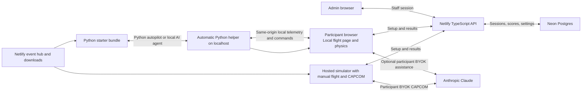

# Dock the Capsule — simplified hosted hackathon plan

Planning baseline: October 12, 2026. Branch: `hackathon`, tracking `origin/hackathon` at `b8fd827`. Target: 12–15 simultaneous participants. Hosting stack: Netlify, TypeScript, and Neon Postgres. Participant autopilots: Python, using the existing `Dragon` interface with an automatically started local bridge. Platform targets: Windows and macOS, initially using Chrome on both and Edge on Windows. AI assistance: optional bring-your-own Anthropic API key (BYOK), called directly from the frontend. This is a plan; no hosting resources or paid API requests have been created.

## 1. Recommended scope

For the hackathon, preserve two participant workflows: fully hosted manual flight with optional BYOK CAPCOM, and Python-controlled flights with an automatic local helper. The hosted simulator and CAPCOM belong in the initial website scope; CAPCOM is optional for the player, not an omitted MVP feature. The Python helper should serve the same simulator assets locally as well as its API, so Python control does not depend on an HTTPS event page obtaining localhost access. Prove both workflows on Windows and macOS before polishing additional features.

Keep the existing JavaScript/Three.js simulator running in participants' browsers. Netlify hosts the event hub, manual/browser-only flight page, downloads, leaderboard/admin UI, and a small TypeScript results API. For Python-controlled flights, distribute a versioned starter bundle containing the same simulator assets, client, and controller example. An automatic Python helper serves that local flight page and its control API. Neon stores participants, sessions, runs, scores, and admin audit records.

Include BYOK CAPCOM in the hosted manual-flight page. Players open the Netlify URL, fly immediately, and enter their own Claude key only if they want coaching. Their browser calls Anthropic directly; they download nothing and run no Python/helper. The advanced AI-agent challenge uses a participant’s own local agent with the Python/HTTP interface and a copyable connection briefing. The organizer does not hold participant keys or maintain a shared AI budget.

Netlify functions handle event access, score submissions, leaderboard queries, and admin actions. All application database access goes through these functions; participants never receive the Neon connection string. The Python client automatically starts a loopback helper, opens the locally served simulator page, and keeps flight commands on the participant's computer. No shared command queue or realtime service is required.



## 2. The three flight modes

| Mode | Experience | Where the decisions happen |
|---|---|---|
| **Manual Flight** | Open the hosted Netlify simulator and fly with the existing buttons/keyboard. Optionally enter a Claude key to enable CAPCOM coaching and debriefs. No download or Python installation. | The participant flies; CAPCOM advises in the browser through direct Anthropic calls. |
| **Build Your Autopilot** | Use an AI coding assistant to write a Python controller and run it on the same computer as the simulator browser. Download the Python client and starter from the website. | Python uses the automatic local bridge; the participant's browser runs the physics. |
| **AI Agent Pilot** | Start the local helper, launch a flight, and copy the generated interface briefing into your own agent. | A participant’s local agent makes live decisions and issues commands through the Python/HTTP bridge. |

No Claude key is required for manual flight, a saved Python autopilot, or the local simulation API. Local agents use the participant's own AI tools/accounts. The website does not execute participant Python. Starting a Python controller automatically starts its local relay; participants do not launch a separate simulation server. Remote/cloud notebooks or agents are outside this local-bridge MVP because their localhost is a different machine.

Use labeled thrusters and full telemetry for the automated tracks. Manual flight and Python autopilots run in real time. Only AI Agent uses turn-based observe/fire/step control, with physics paused while the agent thinks. Retire Role Reversal, scrambled thrusters, dead thrusters, and restricted sensors from the main event.

Each participant must keep the simulator tab open and visible. Closing it stops the simulation. Browser-independent flight is a later feature.

The hosted and locally served simulator use the same source, controls, scenario/rules version, and leaderboard submission format. Manual/CAPCOM runs and Python-controlled runs all appear on the central event site, with their appropriate track/assistance filters. Local packaging changes only how Python-controlled flights open and connect; it does not replace the hosted manual experience.

## 3. Frontend BYOK CAPCOM and pilot

Anthropic's official TypeScript SDK supports browsers when `dangerouslyAllowBrowser: true` is explicitly enabled. The option is disabled by default because credentials are accessible in the client environment. Here that is a participant's own key entered at runtime. [Anthropic TypeScript SDK](https://platform.claude.com/docs/en/cli-sdks-libraries/sdks/typescript).

Proposed interaction:

1. Manual flight offers **Fly solo** and **Enable CAPCOM with your Claude API key**.
2. The participant enters the key in a password field, selects an available model, and enables assistance. Display that requests go directly to Anthropic and are billed to their API account.
3. Keep the key only in tab memory. Clear the input after constructing the client. Provide Disconnect/Clear key; reloading requires re-entry.
4. Send a small telemetry snapshot, recent messages, and the existing coaching prompt to Anthropic. CAPCOM returns short text and has no flight-control tools.
5. Offer a debrief at the participant's request. Keep recent coaching history in tab memory for retrying flights.

Use the same trusted frontend AI module for the direct pilot, with validated observe/fire/step tools and a visible Stop control. CAPCOM and pilot prompts can be ported from `hackathon/claude.py`; no site-side inference endpoint is needed.

Key-handling boundaries:

- Never include the key in a built asset, URL, local/session storage, score upload, trace, error report, or application log.
- Never send it to Netlify or Neon. Build score/telemetry payloads from explicit allowed fields rather than serializing entire app state.
- Participant Python runs in their own environment, separate from the website's JavaScript. The local bridge uses its own pairing credential and telemetry; the website never passes it the browser's CAPCOM key. A browser code editor/runner is outside this MVP.
- Bundle trusted scripts locally, render replies as text, and restrict outbound connections with CSP. Avoid analytics/session-recording scripts on key-entry and flight pages.
- Use dedicated, revocable participant API keys with provider-side spending limits. Memory-only handling still relies on the integrity of the frontend and the participant's browser.
- Make at most one AI request per session at a time. Set bounded history/output, a conservative CAPCOM cadence, request timeouts, and user-visible rate-limit/funding errors. Disable automatic retries that could create unexpected duplicate spending.
- A client-side call/usage allowance is a convenience, not an enforceable billing cap. The participant controls the actual provider limit.

Test direct calls from the deployed Netlify origin with a participant-provided key before launch. If that account's policies or browser block direct API access, offer solo flight and the external-agent route; do not quietly forward the key through the backend.

Removing shared inference also removes the encrypted provider-key database, event AI-spend ledger, budget reservations, and admin funding controls.

## 4. Pages, access, and admin

Proposed routes: `/`, `/fly/manual`, `/fly/autopilot`, `/fly/agent`, `/leaderboard`, `/docs`, and `/admin`.

Participants join with an event code and choose a callsign/team. Create a random expiring session cookie; store its hash and identity in Neon. Callsigns are display names, not credentials. Use Secure, HttpOnly, SameSite cookies, and validate event membership on protected requests. A returning team can use a separate team join code.

For this small event, a configured staff password and an expiring staff session are sufficient; an OAuth/account-management system is unnecessary. Store only a salted password hash in the host's server-side secrets. Staff mutations require authorization and origin/CSRF checks.

Admin controls:

- Event code, opening/closing times, enabled modes, scenario/rules version, and public leaderboard visibility.
- Runs grouped by event, track, callsign, outcome, and manual assistance setting.
- Inspect bounded run traces, label test runs, exclude/restore scores, and export CSV/JSON.
- Inspect final run metadata and submission status. Live local-controller connection status is shown in the participant's flight page.

The admin panel has no participant API-key fields or shared AI budget.

## 5. Automatic local bridge and Python compatibility

Python autopilots and local agents use a helper automatically started inside the Python client process. Reuse the existing `server.py` static-serving and bridge behavior: the helper serves both the packaged simulator assets and the local HTTP control API. The browser page and bridge share one loopback origin, and participants need no separate server command.

Preserve `state()`, `reset()`, `pause()`, `resume()`, `step(seconds)`, `command()`, `commands()`, and named thruster helpers. Preserve established telemetry fields, units, coordinate conventions, and command/count payloads. Each command waits for the browser's acknowledged result and returns the resulting state, as before.

Target connection API after implementation (the current client has not yet changed):

```python
from dragon import Dragon

sim = Dragon.start_event(event_url="https://<site>.netlify.app")
state = sim.reset()
sim.pause()
state = sim.commands(
    {"command": "yaw_left", "count": 2},
    {"command": "step", "seconds": 0.5},
)
```

The connection helper starts the static-serving bridge on an available high loopback port, opens the packaged simulator page at that same local origin, and waits for the browser. The event URL supplies central registration and score submission, not the flight command path. Keep the old `Dragon()` local-server behavior for existing users; add this automatic event mode alongside it.

Provide a versioned ZIP containing `dragon.py`, a starter based on `examples/autopilot.py`, the required simulator assets, local-agent instructions, and a connection status panel. Participants download/unzip once and run their Python controller; the helper handles startup, browser opening, and shutdown. Build hosted and packaged flight assets from the same source/rules version.

### Communication

- Python uses the familiar local `GET /api/state` and `POST /api/command` shapes.
- The locally served browser page exchanges telemetry and queued command results with the helper through an authenticated, same-origin `/bridge/sync` endpoint.
- Coasts and reset animations execute in the browser. The bridge waits for acknowledgment without advancing simulation time during controller thinking.
- Keep one active controller/browser pair per bridge. Use command IDs, bounded batches, validated durations/counts, and a result cache to prevent duplicate burns after retries.
- On disconnect, report stale state explicitly and stop dispatching commands. Do not silently repeat an uncertain burn.
- Frequent bridge traffic stays on localhost. Netlify/Neon receive event setup and results rather than continuous flight telemetry.
- Bind explicitly to `127.0.0.1`, not a public/LAN address; use a random per-bridge credential and validate the matching local page origin. Do not reuse the current server's unrestricted wildcard CORS.
- Use an available port so two Python sessions cannot accidentally control each other's browser. Keep pairing credentials out of score uploads and logs.

### Windows and macOS targets

Use Python 3.11+ and portable standard-library networking, threading, and browser-launch APIs. Avoid platform-specific shell scripts, process spawning assumptions, fixed paths, privileged ports, or a requirement for administrator access. A background helper thread in the controller process is sufficient.

Initial supported event targets: Windows + Chrome/Edge, macOS + Chrome. The same Python controller source and JSON interface should work on both systems. Installation/launch commands may differ (`py` on Windows, `python3` on macOS); the Python API does not.

Serving the flight page and bridge from the same loopback origin avoids the earlier public-website-to-localhost connection and its browser-permission dependency. Localhost pages are treated as potentially trustworthy origins by browsers. The page still makes ordinary cross-origin HTTPS requests for event registration and scores, so configure the hosted results API to allow validated loopback origins and use scoped bearer credentials for local-page submissions; do not rely on cross-site cookies. Hosted admin pages retain their normal same-origin staff sessions. [MDN secure contexts](https://developer.mozilla.org/en-US/docs/Web/Security/Defenses/Secure_Contexts).

Safari and Firefox are additional compatibility targets only after testing. No integrated cross-platform event launcher has been verified yet. Before the event, test the ZIP and launch path on Windows and macOS for browser opening, command round trips, pause/step, port conflicts, reconnects, score submission, and clean shutdown. Test optional BYOK independently from the core flight path.

Remote/cloud controllers would need the earlier hosted relay or a separate explicitly configured connection. Keep that as a later option if the event actually needs it.

### Hosted API remaining in the MVP

| Endpoint | Purpose |
|---|---|
| `POST /api/join` | Join the event; establish a hosted participant session or issue a scoped event credential for the local flight page. |
| `POST /api/runs` | Create an owned run with a fixed track/scenario and a server-issued run ID. |
| `POST /api/runs/{id}/finish` | Submit an outcome for consistency checks and leaderboard recording. |
| `POST /api/runs/{id}/abort` | Mark the attempt as aborted. |
| `GET /api/leaderboard` | Fetch best successful results by event/track/scenario. |
| Protected admin endpoints | Inspect/exclude/restore results, configure the event, and export records. |

Connect to Neon from Netlify Functions with `@neondatabase/serverless` and a Functions-scoped `DATABASE_URL`. Use parameterized queries and atomic operations for run finalization. Keep source and secrets outside the static publish directory. [Neon serverless driver](https://github.com/neondatabase/serverless).

## 6. Leaderboard and records

Separate boards for Manual Flight, Build Your Autopilot, and AI Agent Pilot. Manual results include an assisted/unassisted filter, since CAPCOM is optional. Record the selected model for BYOK pilots and label external agents without attempting to verify their provider.

Compare the same scenario and rules version. Rank successful runs by simulation time to dock, then pulse count. Show wall time separately. Resets produce new attempts; show one best successful attempt per participant/team per board. Keep failed attempts for inspection.

Neon stores events, participants/teams, hashed sessions, runs/attempts, bounded submitted traces, and admin audit entries. Index leaderboard queries. Keep live state and command queues in the local bridge rather than the database. Avoid physics-frame archives and continuous transcripts.

Results remain browser-reported with server consistency checks and admin review. Reject duplicate finishes, implausible numbers, invalid sequences, and obvious clock inconsistencies. Stronger deterministic replay verification requires extracting physics/collision behavior and is outside this MVP.

## 7. Free hosting and operational checks

Use Netlify static assets and short TypeScript functions with a dedicated Neon Free project. No Supabase project or shared Claude credit balance is required.

Neon's October 2, 2026 update lists 100 free projects, 1 GB Postgres storage per project, and 100 CU-hours of database compute per project/month. That gives ample starting room for this small event's records; confirm allowances in the actual Neon account and measure score/admin query load. [Neon free-plan update](https://neon.com/blog/neon-free-plan-1-gb-per-project).

Netlify's current credit-based Free plan has a shared 300-credit monthly cap. Requests, function compute, bandwidth, and production deploys consume that allowance. Direct browser-to-Anthropic inference does not hold a Netlify function open while Claude thinks. Local bridge polling does not consume hosting requests. Keep leaderboard refreshes modest and benchmark score/admin traffic. [Netlify pricing](https://docs.netlify.com/manage/accounts-and-billing/billing/billing-for-credit-based-plans/credit-based-pricing-plans/).

Cache versioned 3D assets, use deploy previews during development, and measure hosted request latency/credits, Neon compute/storage, and local bridge pairing/reconnect behavior with 15 clients. Database scale-to-zero/cold starts can add latency to the first request; tolerate this during join/start and rehearse from idle. Export results before and after the event.

Separate test data and event data. If a Netlify site is linked later, add `.netlify/` to `.gitignore`. Participants never need to install a server. The autopilot track requires Python on the same computer as the browser and the downloaded starter bundle including simulator assets. This is an intentional setup tradeoff for reusing the existing local control path. Hosted manual flight needs only a browser; CAPCOM coaching optionally uses a participant API key.

## 8. Implementation milestones

1. **Hosted simulator + BYOK CAPCOM:** deploy the existing simulator to Netlify, add manual flight and direct-browser CAPCOM with in-memory key entry, and verify both on Windows/Chrome and macOS/Chrome. Players must be able to fly solo immediately with no download. A missing key, blocked request, or provider outage must not block solo flight.
2. **Python flight path:** create the automatic helper/launcher and starter ZIP from the same simulator source. Test the reference autopilot, local AI-agent tools, pause/step, and clean startup/shutdown on Windows/Chrome and macOS/Chrome. One Python command must open a controllable simulator without a second server command.
3. **Central scores and admin:** add Neon migrations, event access, score submission from hosted/local pages, leaderboard, and staff inspection/export. Verify bearer-based local submissions, persistent results, rules-version checks, and a clear retry if score upload fails. Save a local result receipt so a temporary outage does not discard a flight.
4. **Fresh-participant rehearsal:** have 2–3 people on different computers try the hosted manual/CAPCOM page and follow the Python download/unzip/run instructions from scratch. Fix setup friction before visual polish. The agent setup includes a Copy agent briefing button with actual connection details.
5. **15-client event rehearsal:** exercise all core tracks, Chrome on Windows/macOS, Windows/Edge as an additional target, visibility loss, port conflicts, reconnects, database idle startup, score retry/export, and actual hosting allowances. Freeze the tested starter bundle and event rules version before the event.

The MVP is a fully hosted manual simulator with optional BYOK CAPCOM, Python autopilot challenge, local AI-agent challenge, central leaderboard, and staff controls. Keep hosted command relays, cloud-controller support, browser Python execution, accounts/OAuth, and strict replay verification for later. Participants choose whether to enable CAPCOM; its availability is part of the website scope.
